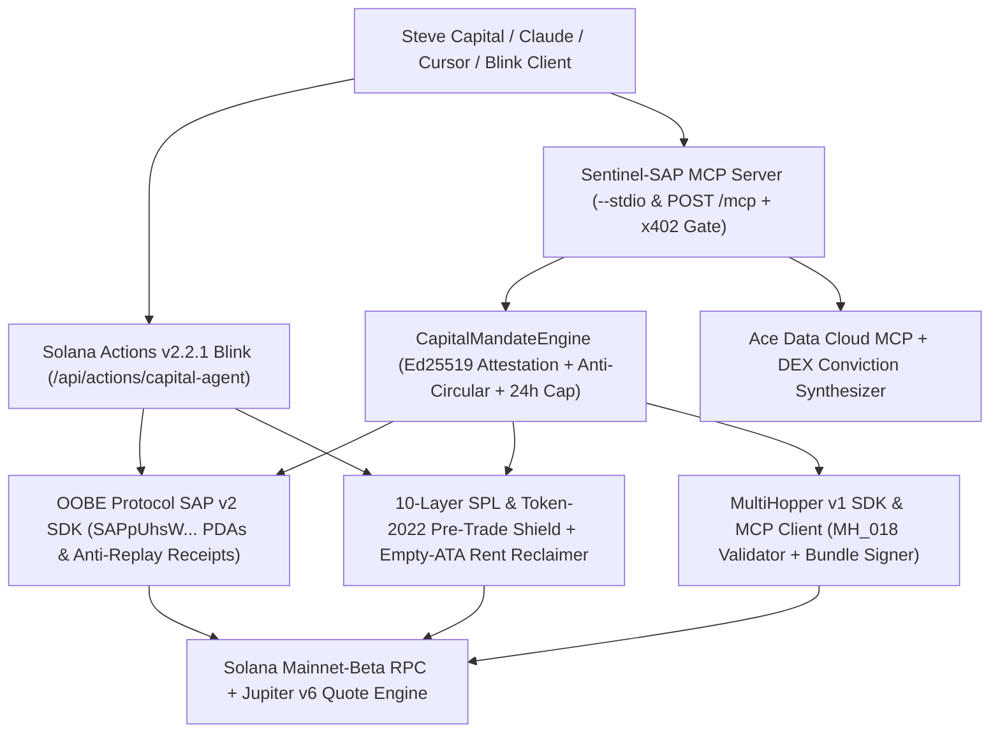

# Sentinel-SAP (`@sentinel-sap/autonomous-capital-agent`)

**Autonomous Solana Capital & Treasury Routing Agent built on OOBE Protocol SAP v2 (`@oobe-protocol-labs/synapse-sap-sdk`), MultiHopper Programmable Routing MCP/API, 10-Layer SPL/Token-2022 Pre-Trade Guardrails, Empty-ATA Rent Compounding, Solana Actions v2.2.1 Blinks, and x402 MCP Agentic Commerce.**

> **Superteam Earn Target Bounty:** [Build an Autonomous Capital Agent on Solana & Compete for $500 in Rewards](https://earn.superteam.fun/listing/build-an-autonomous-capital-agent-on-solana-and-compete-for-dollar500-in-rewards)  
> **Sponsor:** OOBE Protocol (`Steve Capital`), featuring **MultiHopper** (`Agent Routing Challenge`) & **Ace Data Cloud** (`MCP Conviction`)  
> **Status:** `OPEN` | **Deadline:** `2026-12-10T22:59:59.000Z` | **Reward Pool:** **`$500 USDC`** (`250 USDC` Main Track + `125 USDC` MultiHopper Track + `$125` Ace Data Cloud Track)

---

## 1. Problem Statement & Solution

Autonomous capital agents on Solana routinely lose principal to three preventable failure modes:
1. **Unbounded Execution Risk:** Agents execute swaps without on-chain authority/extension inspection, getting trapped in Token-2022 `PermanentDelegate`, `NonTransferable`, or excessive `TransferFeeConfig` honeypots, or breaching daily risk mandates.
2. **Idle Rent Leakage:** High-frequency DeFi and routing workflows leave dozens of zero-balance SPL and Token-2022 Associated Token Accounts (`~0.00203928 SOL` each) locked on-chain, while naive batch-close scripts revert whenever a single token account is frozen or holds unharvested Token-2022 transfer fees.
3. **Linkable Treasury Disbursements:** Direct single-hop agent payouts expose treasury wallets and recipient clusters without TRM compliance screening or programmable multi-destination routing.

**Sentinel-SAP** solves all three in a unified, zero-placeholder TypeScript SDK, JSON-RPC 2.0 Model Context Protocol (MCP) Server, and Solana Actions v2.2.1 Blink:
- **Native OOBE Protocol SAP v2 Identity & Guardrails (`src/sap-agent.ts`, `src/mandate.ts`):** Derives deterministic on-chain SAP v2 accounts (`AgentAccount`, `MemoryVault`, `VaultDelegate`, `AgentStats`, `PricingMenu`, `AgentStake`, `Tool`, and v0.10.0 anti-replay `SettlementReceipt` PDAs) against mainnet program `SAPpUhsWLJG1FfkGRcXagEDMrMsWGjbky7AyhGpFETZ` and enforces Ed25519-attested spending caps, rolling 24h budgets, sub-agent delegation bounds, and anti-circular transfer rules.
- **10-Layer SPL & Token-2022 Pre-Trade Risk Shield (`src/shield-and-rent.ts`):** Inspects live Solana mainnet mints and DEX pools before allowing any Jupiter swap.
- **Fault-Tolerant Empty-ATA Rent Compounding (`src/shield-and-rent.ts`):** Builds non-custodial `VersionedTransaction` (`MessageV0`) `CloseAccount` batches while automatically skipping frozen ATAs and withheld-fee Token-2022 accounts.
- **MultiHopper Programmable Routing SDK & MCP Bridge (`src/multihopper.ts`):** Auto-discovers MultiHopper's live MCP Server Card (`v1.1.0`), validates `MH_018` custom routes (`2-10` hops, up to `20` multi-send destinations), computes `50 bps` fee / `25 bps` partner rev-share economics, and non-custodially signs `PreparedTxBundle` (`routeInitTxs` -> `dispersionInitTxs`) in strict order.
- **Ace Data Cloud Conviction Engine + x402 MCP + Solana Actions v2.2.1 (`src/ace-conviction.ts`, `src/mcp-server.ts`, `src/http-server.ts`):** Exposes 7 MCP tools over `--stdio` and Streamable HTTP `/mcp` with open discovery (`HTTP 200`) and `HTTP 402` Solana payment gating, alongside CORS-compliant Solana Blinks.

---

## 2. System Architecture



---

## 3. Quickstart

```bash
cd sentinel-sap-autonomous-capital-agent

# 1. Install dependencies
npm install

# 2. Strict TypeScript typecheck & production build
npm run typecheck
npm run build

# 3. Run full unit + live Solana mainnet integration test suite (12/12 tests)
npm test

# 4. Run deterministic 6-stage live mainnet & ecosystem proof
./run_demo.sh
```

---

## 4. CLI, MCP Server & Solana Actions v2.2.1 API Reference

### CLI Commands (`npx tsx src/cli.ts <command>`)
| Command | Description |
| :--- | :--- |
| `sap-identity [wallet]` | Derives OOBE SAP v2 PDAs (`AgentAccount`, `MemoryVault`, `VaultDelegate`, `Tool` x6) and queries live Solana mainnet `GlobalRegistry` & wallet state. |
| `audit-mint [mint]` | Runs live 10-Layer SPL / Token-2022 risk audit on Solana mainnet + DexScreener liquidity telemetry. |
| `scan-rent [wallet]` | Scans live SPL & Token-2022 token accounts, skips frozen/withheld-fee ATAs, and outputs a base64 `CloseAccount` `VersionedTransaction`. |
| `mcp-stdio` | Starts the JSON-RPC 2.0 MCP server (`protocolVersion: 2024-11-05`) over `stdin`/`stdout` for Steve Capital / Claude / Cursor MCP Workspace. |
| `serve [port]` | Starts the Streamable HTTP MCP (`/mcp` + x402 gate) and Solana Actions v2.2.1 Blink server (`/api/actions/capital-agent`). |

### Exposed MCP Tools (`7` Tools)
1. `sap_derive_agent_identity` - Deterministic OOBE SAP v2 PDA tree + optional live Solana mainnet RPC inspection.
2. `shield_audit_token_mint` - 10-Layer SPL & Token-2022 pre-trade risk audit (`SAFE` / `CAUTION` / `BLOCKED`).
3. `reclaim_empty_atas_tx` - Zero-balance SPL/Token-2022 ATA discovery + `VersionedTransaction` builder.
4. `mandate_evaluate_execution` - Programmable mandate evaluation + SAP v0.10.0 `SettlementReceipt` anti-replay PDA derivation.
5. `multihopper_plan_and_quote` - Client-side `MH_018` route validation + `50 bps` / `25 bps` economics + MultiHopper MCP discovery.
6. `jupiter_build_guarded_swap` - Pre-trade 10-Layer Shield + Mandate gate + live Jupiter swap quote (`https://lite-api.jup.ag/swap/v1/quote`).
7. `ace_research_conviction_brief` - Blended on-chain 10-Layer Shield + Ace Data Cloud SERP conviction brief (`CORE_ALLOCATION` / `TACTICAL_SATELLITE` / `DO_NOT_ALLOCATE`).

### Solana Actions v2.2.1 & x402 HTTP Endpoints
- `GET /.well-known/mcp/server-card.json` - MCP discovery card (`HTTP 200`).
- `GET /actions.json` - Solana Actions URL mapping rules (`HTTP 200`).
- `GET /api/actions/capital-agent` - Blink metadata (`X-Action-Version: 2.2.1`, `X-Blockchain-Ids: solana:5eykt4UsFv8P8NJdTREpY1vzqKqZKvdp`).
- `POST /api/actions/capital-agent?mode=vault-deposit&sol=0.15` - Returns unsigned base64 `VersionedTransaction` anchored to live Solana mainnet blockhash.
- `POST /api/actions/capital-agent?mode=ata-rent-sweep` - Returns unsigned base64 `CloseAccount` rent-compounding `VersionedTransaction`.
- `POST /mcp` - Streamable HTTP MCP JSON-RPC endpoint (`initialize`, `ping`, `tools/list` always `HTTP 200`; `tools/call` enforces configurable free sample allowance then `HTTP 402` x402 payment gate to `89Sv5FvnMNRid1bn8y2Ti1vJPSxWxgiW9GSLsPpBnKK1`).

---

## 5. Security & Competition Compliance Design

- **Zero Private Key Custody:** MultiHopper `PreparedTxBundle` and Solana Actions Blink transactions are constructed unsigned (`MessageV0`) and signed strictly client-side or by scoped sub-agent `Keypair`s with Ed25519 signature verification before broadcast.
- **Anti-Circular & Anti-Wash-Trading Enforcement:** `CapitalMandateEngine` and `validateMultiHopperRequest` explicitly block `sourceOwner == recipientWallet`, self-destinations, endpoint-colliding hops, and duplicate intermediate hop wallets - enforcing OOBE & MultiHopper competition integrity rules in code.
- **SAP v0.10.0 Settlement Anti-Replay:** Every evaluated `ExecutionIntent` produces a canonical SHA-256 `serviceHash` mapped to OOBE SAP's `["sap_recv", escrow_pda, service_hash]` `SettlementReceipt` PDA, preventing duplicate execution or x402 signature replay.
- **Zero-Revert ATA Batching:** Automatically excludes `state === "frozen"` and non-zero `transferFeeAmount.withheldAmount` Token-2022 accounts so batch rent sweeps never fail on-chain.

---

## 6. Verified Test Suite Summary (`12/12 PASS`, `0 FAIL`)

```text
> @sentinel-sap/autonomous-capital-agent@1.0.0 test
> tsx --test tests/*.test.ts

ok 1 - OOBE Protocol SAP v2 Identity & Programmable Capital Mandates (3/3 subtests)
ok 2 - MCP JSON-RPC + x402 Gate + Solana Actions v2.2.1 Blink + Live Mainnet RPC (3/3 subtests)
ok 3 - MultiHopper Programmable Routing SDK & Ace Data Cloud Conviction (3/3 subtests)
ok 4 - 10-Layer SPL / Token-2022 Risk Shield & Empty-ATA Rent Compounding (3/3 subtests)
1..4
# tests 12 | suites 4 | pass 12 | fail 0
```
